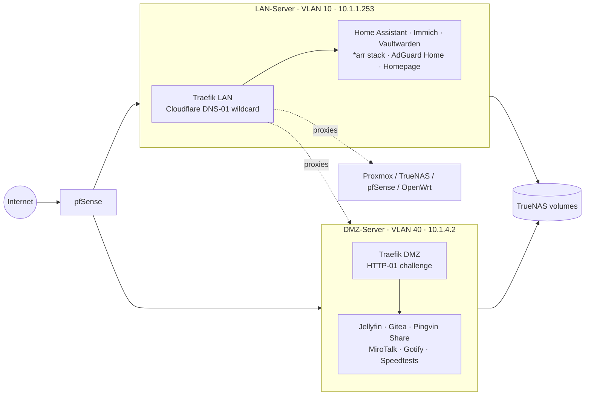

# My Homelab


Docker Compose configurations for my self-hosted homelab: a segmented setup with an internal **LAN server** for private services and a **DMZ server** for anything exposed to the internet, each fronted by its own Traefik reverse proxy with automatic Let's Encrypt certificates.

> 🚧 **Work in progress.** This repo is actively being built out. Services, layout and conventions may change without notice, and the provisioning side of the lab (Ansible playbooks, Terraform for Proxmox) will be added over time. See the [Roadmap](#roadmap).

---

## Architecture

The lab is built on a Proxmox host. Everything except the access point runs as a VM on it: pfSense (routing and firewall), TrueNAS (storage), and the two Docker hosts, LAN-Server and DMZ-Server. An OpenWrt device serves purely as a wireless access point and managed switch.

| Component | Runs as | Role |
| --- | --- | --- |
| **Proxmox** | Bare metal | Hypervisor |
| **pfSense** | Proxmox VM | Router, firewall, network segmentation |
| **TrueNAS** | Proxmox VM | Storage, NAS shares for Docker volumes |
| **LAN-Server** | Proxmox VM | Docker host for internal services |
| **DMZ-Server** | Proxmox VM | Docker host for internet-facing services |
| **OpenWrt** | Dedicated device | Wireless access point and managed switch |

### Network

pfSense segments the network into four VLANs:

| VLAN | Name | Purpose |
| --- | --- | --- |
| 10 | **LAN** | Trusted devices and internal services |
| 20 | **UNTRUSTED** | Devices that shouldn't reach the rest of the network |
| 30 | **IOT** | Smart home and IoT devices |
| 40 | **DMZ** | Internet-facing services |

### Docker hosts

Docker workloads are split across two VMs, one in the LAN VLAN and one in the DMZ VLAN:

| Host | VLAN | Address | Role |
| --- | --- | --- | --- |
| **LAN-Server** | 10 | `10.1.1.253` | Internal-only services: home automation, media management, DNS, passwords, monitoring, dashboards |
| **DMZ-Server** | 40 | `10.1.4.2` | Internet-facing services: media streaming, file sharing, Git, video calls, speed tests, notifications |



All services are reachable at `https://<service>.ssankur.com`.

- **LAN Traefik** obtains a wildcard `*.ssankur.com` certificate via the Cloudflare DNS-01 challenge, so internal services get valid TLS without being publicly reachable. It also proxies the infrastructure UIs (Proxmox, TrueNAS, pfSense, OpenWrt, Scrutiny) and the DMZ-hosted admin UIs.
- **DMZ Traefik** uses the HTTP-01 challenge and only routes the services meant to be public.
- Routing is defined with Traefik's **file provider** (inline in each `docker-compose.yaml` via Compose `configs`) rather than container labels, so each proxy's routing table lives in one place.

## Services

### LAN-Server

| Category | Service | Purpose |
| --- | --- | --- |
| Networking | [Traefik](https://traefik.io/) | Reverse proxy and TLS termination |
| | [AdGuard Home](https://adguard.com/adguard-home.html) | Network-wide DNS and ad blocking (custom patched build) |
| Home automation | [Home Assistant](https://www.home-assistant.io/) | Home automation hub (with HACS) |
| | [ESPHome](https://esphome.io/) | Firmware for ESP-based devices |
| | [Mosquitto](https://mosquitto.org/) | MQTT broker |
| | [Music Assistant](https://music-assistant.io/) | Music library and multi-room playback |
| | [LedFx](https://www.ledfx.app/) | Audio-reactive LED effects |
| | [Piper](https://github.com/rhasspy/piper) / [Wyoming Vosk](https://github.com/rhasspy/wyoming-vosk) | Local text-to-speech and speech-to-text for voice assistants |
| Media management | [Sonarr](https://sonarr.tv/) / [Radarr](https://radarr.video/) | TV and movie management |
| | [Prowlarr](https://prowlarr.com/) | Indexer manager |
| | [Bazarr](https://www.bazarr.media/) | Subtitle management |
| | [FlareSolverr](https://github.com/FlareSolverr/FlareSolverr) | Cloudflare challenge solver for indexers |
| Personal data | [Immich](https://immich.app/) | Photo and video backup |
| | [Vaultwarden](https://github.com/dani-garcia/vaultwarden) | Bitwarden-compatible password manager |
| | [Ente Auth](https://ente.io/auth/) | Self-hosted 2FA / TOTP sync |
| | [Radicale](https://radicale.org/) | CalDAV / CardDAV server (custom build) |
| | [Grocy](https://grocy.info/) | Groceries and household management |
| Monitoring & admin | [Homepage](https://gethomepage.dev/) | Dashboard with service widgets |
| | [Gatus](https://gatus.io/) | Uptime and health monitoring (alerts via Gotify) |
| | [Dozzle](https://dozzle.dev/) | Real-time container logs |
| | [Dockhand](https://github.com/fnsys/dockhand) | Docker management UI |
| | [Adminer](https://www.adminer.org/) | Database management |

### DMZ-Server

| Category | Service | Purpose |
| --- | --- | --- |
| Networking | [Traefik](https://traefik.io/) | Public-facing reverse proxy |
| | [Socket Proxy](https://docs.linuxserver.io/images/docker-socket-proxy/) | Docker API access for remote management from the LAN |
| Media | [Jellyfin](https://jellyfin.org/) | Media streaming |
| | [qBittorrent](https://www.qbittorrent.org/) | Torrent client |
| | qBittorrent (VPN) | Torrent client routed through a WireGuard tunnel |
| Sharing & collaboration | [Gitea](https://about.gitea.com/) | Self-hosted Git |
| | [Pingvin Share](https://github.com/stonith404/pingvin-share) | File sharing |
| | [MiroTalk SFU](https://github.com/miroslavpejic85/mirotalksfu) | Video conferencing |
| | [Nginx](https://nginx.org/) | Static site hosting |
| Notifications | [Gotify](https://gotify.net/) | Push notifications |
| | [Mailrise](https://github.com/YoRyan/mailrise) | SMTP-to-Gotify bridge for devices that only send email alerts (pfSense, TrueNAS, …) |
| Speed tests | [LibreSpeed](https://github.com/librespeed/speedtest) / [OpenSpeedTest](https://openspeedtest.com/) | Network speed testing |

## Repository structure

```
Docker/
├── LAN-Server/
│   └── <service>/
│       ├── docker-compose.yaml
│       └── Dockerfile          # only for custom-built images (adguard-home, radicale)
└── DMZ-Server/
    └── <service>/
        └── docker-compose.yaml
```

Each service is a self-contained Compose project in its own folder. Persistent data lives in a `./mounts/` directory next to each compose file (not tracked in git).

## Conventions

- One Compose project per service, one folder per service.
- All containers join a shared external Docker network named `ssankur`, so Traefik can reach them by container name.
- Host ports are only published where needed (Traefik, DNS, MQTT, SMTP, etc.) and are bound to the host's specific IP rather than `0.0.0.0`.
- Small service configs are embedded inline using Compose `configs:` with `content:`, keeping each service to a single file.
- NAS shares are attached as external Docker volumes (e.g. `TrueNAS`, `Vault`, `TrueNAS-RO-Movies`) created on each host beforehand.
- Timezone is set to `Asia/Dhaka`; LinuxServer.io images run as `PUID/PGID=1000`.

## Getting started

These files describe my environment, so IPs, domains and volume names will need adapting before they're useful elsewhere.

1. Create the shared network on each host:
   ```bash
   docker network create ssankur
   ```
2. Create any external volumes the service needs (see the `volumes:` section in its compose file).
3. Provide the required secrets in a `.env` file next to the compose file (see below).
4. Start the reverse proxy first, then the service:
   ```bash
   cd Docker/LAN-Server/traefik && docker compose up -d
   cd ../vaultwarden && docker compose up -d
   ```
5. If the service uses a custom image (`adguard-home`, `radicale`), build it first with `docker build -t ssankur/<service>:latest .` in that folder.

## Secrets

No secrets are committed. Compose files reference them as `${VARIABLE}` placeholders, which are read from a `.env` file in each service directory, for example:

| Service | Variables |
| --- | --- |
| traefik (LAN) | `CF_DNS_API_TOKEN` |
| qbittorrent-vpn | `PRIVATE_KEY`, `PUBLIC_KEY`, `VPN_SERVER_IP` |
| immich, ente | `DB_PASSWORD` |
| mailrise | `SMTP_PASSWORD`, `GOTIFY_TOKEN_*` |
| homepage | API keys / passwords for each dashboard widget |

`.env` files and `mounts/` data only ever exist on the servers themselves and never pass through this repo (see [Workflow](#workflow)).

## Workflow

Changes are made in a local clone on my desktop and pushed here; the servers never push to this repo. The plan is to move to a GitOps model: for the Docker hosts, each server pulls its own folder (`Docker/LAN-Server` or `Docker/DMZ-Server`) and redeploys from this repo, with secrets and persistent data staying local to each host. Once k3s is in place, Flux or Argo CD will handle deployments to the cluster.

## Roadmap

The goal is to manage the whole lab as code, from the VMs up to the apps:

- **Ansible:** I'll upload the playbooks I use to provision the servers.
- **Terraform:** I'll start using Terraform to define the Proxmox VM configurations, so the VMs themselves are reproducible.
- **k3s:** Stateless services will move to a lightweight k3s cluster, while stateful services (databases, media, personal data) stay on Docker Compose.
- **GitOps with Flux / Argo CD:** The k3s cluster will be reconciled from this repo using Flux or Argo CD, so pushing a change here is all it takes to deploy it.

### Status / to do

- [ ] **Ansible:** upload server provisioning playbooks
- [ ] **Terraform:** define the Proxmox VM configurations as code
- [ ] **GitOps (Compose):** servers pulling and deploying from this repo automatically
- [ ] **k3s:** set up the cluster and migrate stateless services to it
- [ ] **Flux / Argo CD:** GitOps deployments for the k3s cluster
- [ ] Documentation for the Proxmox, TrueNAS, pfSense and OpenWrt side of the lab
- [ ] Network diagram and firewall rules between the VLANs
- [ ] Backup and restore notes

## Disclaimer

This repository reflects my personal setup and is shared for reference. Use anything here at your own risk, and review each configuration before deploying it in your own environment.
