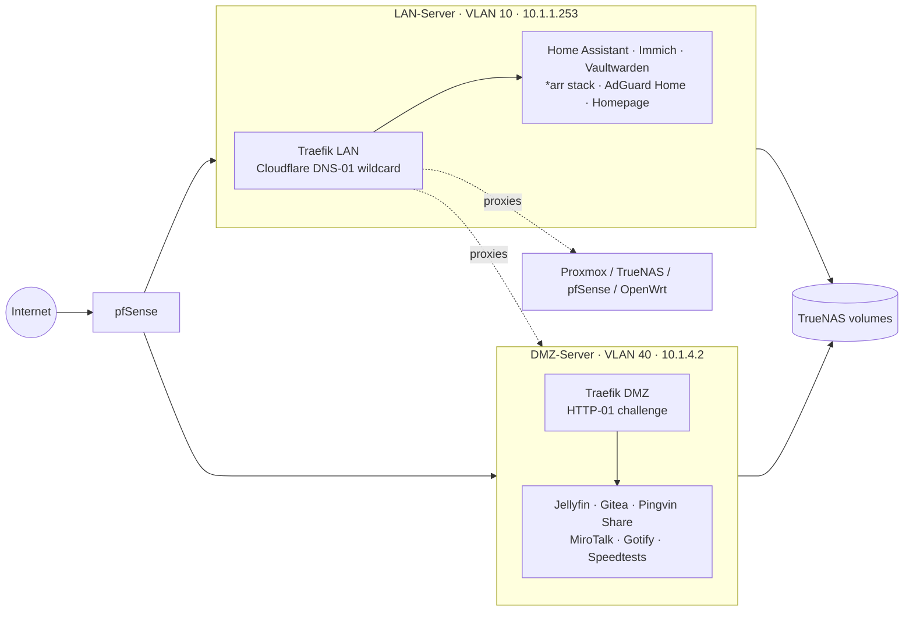

# My Homelab


Ansible playbooks and Docker Compose configurations for my self-hosted homelab: a segmented setup with an internal **LAN server** for private services and a **DMZ server** for anything exposed to the internet, each fronted by its own Traefik reverse proxy with automatic Let's Encrypt certificates. Ansible provisions the hosts themselves (Proxmox, the Docker VMs and a cloud VPS), and Docker Compose runs the services on top.

> 🚧 **Work in progress.** This repo is actively being built out. Services, layout and conventions may change without notice, and more of the lab (Terraform for Proxmox, GitOps for both Ansible and Compose) will be added over time. See the [Roadmap](#roadmap).

---

## Architecture

The lab is built on a Proxmox host. Everything except the access point runs as a VM on it: pfSense (routing and firewall), TrueNAS (storage), and the two Docker hosts, LAN-Server and DMZ-Server. An OpenWrt device serves purely as a wireless access point and managed switch. Outside the house, a small cloud VPS runs WireGuard.

| Component | Runs as | Role |
| --- | --- | --- |
| **Proxmox** | Bare metal | Hypervisor |
| **pfSense** | Proxmox VM | Router, firewall, network segmentation |
| **TrueNAS** | Proxmox VM | Storage, NAS shares for Docker volumes and backups |
| **LAN-Server** | Proxmox VM | Docker host for internal services |
| **DMZ-Server** | Proxmox VM | Docker host for internet-facing services |
| **OpenWrt** | Dedicated device | Wireless access point and managed switch |
| **Cloud-Server** | Cloud VPS (Debian) | WireGuard endpoint with IP forwarding |

### Network

pfSense segments the network into four VLANs:

| VLAN | Name | Purpose |
| --- | --- | --- |
| 10 | **LAN** | Trusted devices and internal services |
| 20 | **UNTRUSTED** | Devices that shouldn't reach the rest of the network |
| 30 | **IOT** | Smart home and IoT devices |
| 40 | **DMZ** | Internet-facing services |

### Docker hosts

Docker workloads are split across two VMs, one in the LAN VLAN and one in the DMZ VLAN:

| Host | VLAN | Address | Role |
| --- | --- | --- | --- |
| **LAN-Server** | 10 | `10.1.1.253` | Internal-only services: home automation, media management, DNS, passwords, monitoring, dashboards |
| **DMZ-Server** | 40 | `10.1.4.2` | Internet-facing services: media streaming, file sharing, Git, video calls, speed tests, notifications |



All services are reachable at `https://<service>.ssankur.com`.

- **LAN Traefik** obtains a wildcard `*.ssankur.com` certificate via the Cloudflare DNS-01 challenge, so internal services get valid TLS without being publicly reachable. It also proxies the infrastructure UIs (Proxmox, TrueNAS, pfSense, OpenWrt, Scrutiny) and the DMZ-hosted admin UIs.
- **DMZ Traefik** uses the HTTP-01 challenge and only routes the services meant to be public.
- Routing is defined with Traefik's **file provider** (inline in each `docker-compose.yaml` via Compose `configs`) rather than container labels, so each proxy's routing table lives in one place.

## Services

### LAN-Server

| Category | Service | Purpose |
| --- | --- | --- |
| Networking | [Traefik](https://traefik.io/) | Reverse proxy and TLS termination |
| | [AdGuard Home](https://adguard.com/adguard-home.html) | Network-wide DNS and ad blocking (custom patched build) |
| Home automation | [Home Assistant](https://www.home-assistant.io/) | Home automation hub (with HACS) |
| | [ESPHome](https://esphome.io/) | Firmware for ESP-based devices |
| | [Mosquitto](https://mosquitto.org/) | MQTT broker |
| | [Music Assistant](https://music-assistant.io/) | Music library and multi-room playback |
| | [LedFx](https://www.ledfx.app/) | Audio-reactive LED effects |
| | [Piper](https://github.com/rhasspy/piper) / [Wyoming Vosk](https://github.com/rhasspy/wyoming-vosk) | Local text-to-speech and speech-to-text for voice assistants |
| Media management | [Sonarr](https://sonarr.tv/) / [Radarr](https://radarr.video/) | TV and movie management |
| | [Prowlarr](https://prowlarr.com/) | Indexer manager |
| | [Bazarr](https://www.bazarr.media/) | Subtitle management |
| | [FlareSolverr](https://github.com/FlareSolverr/FlareSolverr) | Cloudflare challenge solver for indexers |
| Personal data | [Immich](https://immich.app/) | Photo and video backup |
| | [Vaultwarden](https://github.com/dani-garcia/vaultwarden) | Bitwarden-compatible password manager |
| | [Ente Auth](https://ente.io/auth/) | Self-hosted 2FA / TOTP sync |
| | [Radicale](https://radicale.org/) | CalDAV / CardDAV server (custom build) |
| | [Grocy](https://grocy.info/) | Groceries and household management |
| Monitoring & admin | [Homepage](https://gethomepage.dev/) | Dashboard with service widgets |
| | [Gatus](https://gatus.io/) | Uptime and health monitoring (alerts via Gotify) |
| | [Dozzle](https://dozzle.dev/) | Real-time container logs |
| | [Dockhand](https://github.com/fnsys/dockhand) | Docker management UI |
| | [Adminer](https://www.adminer.org/) | Database management |

### DMZ-Server

| Category | Service | Purpose |
| --- | --- | --- |
| Networking | [Traefik](https://traefik.io/) | Public-facing reverse proxy |
| | [Socket Proxy](https://docs.linuxserver.io/images/docker-socket-proxy/) | Read-only Docker API access for monitoring from the LAN (Dockhand, Dozzle, Homepage, Gatus) |
| Media | [Jellyfin](https://jellyfin.org/) | Media streaming |
| | [qBittorrent](https://www.qbittorrent.org/) | Torrent client |
| | qBittorrent (VPN) | Torrent client routed through a WireGuard tunnel |
| Sharing & collaboration | [Gitea](https://about.gitea.com/) | Self-hosted Git |
| | [Pingvin Share](https://github.com/stonith404/pingvin-share) | File sharing |
| | [MiroTalk SFU](https://github.com/miroslavpejic85/mirotalksfu) | Video conferencing |
| | [Nginx](https://nginx.org/) | Static site hosting |
| Notifications | [Gotify](https://gotify.net/) | Push notifications |
| | [Mailrise](https://github.com/YoRyan/mailrise) | SMTP-to-Gotify bridge for devices that only send email alerts (pfSense, TrueNAS, …) |
| Speed tests | [LibreSpeed](https://github.com/librespeed/speedtest) / [OpenSpeedTest](https://openspeedtest.com/) | Network speed testing |

## Provisioning with Ansible

Each host has its own playbook under `Ansible/<host>/`, built from a set of shared roles in `Ansible/roles/`. Each playbook lists the roles its host needs and keeps only the tasks unique to that host, so a host can still be rebuilt from a fresh OS install with a single run.

| Playbook | Target | What it does |
| --- | --- | --- |
| `LAN-Server.yml` | LAN-Server | Base system setup, Docker, PipeWire audio, NAS mounts and volumes, restores and starts all services, rclone + Restic backups |
| `DMZ-Server.yml` | DMZ-Server | Base system setup, Docker, NAS mounts and volumes, restores and starts all services |
| `Cloud-Server.yml` | Cloud-Server | Base system setup, tooling, IP forwarding and the WireGuard `wg0` tunnel |
| `Proxmox.yml` | Proxmox | Hostname, timezone and shell config, cron environment, full package upgrade and cleanup, Gotify notification when a reboot is required |

### Roles

| Role | What it does | Used by |
| --- | --- | --- |
| `base` | Hostname (from the inventory name) and `Asia/Dhaka` timezone | All hosts |
| `bash` | Shell config files copied to the user's home | All hosts |
| `repos` | Extra apt repositories and keyrings (Docker, Ookla) | Cloud, LAN, DMZ |
| `packages` | Installs the host's packages | Cloud, LAN, DMZ |
| `user` | Passwordless sudo, group membership, SSH keys and helper scripts | LAN, DMZ |
| `autofs` | autofs maps for the TrueNAS shares, restarting autofs when they change | LAN, DMZ |
| `docker` | Shared network, NFS volumes, Docker Hub login, restoring and starting services | LAN, DMZ |
| `cron` | Cron jobs | LAN, DMZ, Proxmox |

The roles only contain tasks; everything that differs between hosts comes from variables.

### Variables

The inventory (`Ansible/hosts.yml`) puts LAN-Server and DMZ-Server in a `docker_hosts` group, and the roles read their values from `group_vars` and `host_vars`:

| File | Holds |
| --- | --- |
| `group_vars/all/vars.yml` | Packages installed on every host (`packages_all`) |
| `group_vars/docker_hosts/vars.yml` | Settings shared by both Docker hosts: shell files, the Docker repo, the `docker` group, shared cron jobs and packages |
| `host_vars/<host>/vars.yml` | Each host's own packages, repos, groups, cron jobs and Docker volumes |

Lists that are shared between levels use one variable per level (`packages_all`, `packages_group` and `packages`, for example), and the roles join them together, so a host gets the shared items plus its own.

### Rebuilding a Docker host

The LAN-Server and DMZ-Server playbooks take a freshly installed Debian VM to a fully running Docker host:

1. **Base system:** hostname, `Asia/Dhaka` timezone and shell config.
2. **Packages:** Docker CE (with the Compose and Buildx plugins) from Docker's official apt repository, plus the usual admin tooling. LAN-Server also gets PipeWire, rclone and Restic.
3. **User setup:** passwordless sudo for `ssankur`, membership of the `docker` group (and `pipewire` on LAN-Server), SSH keys and helper scripts. This runs after the packages, because those groups only exist once Docker and PipeWire are installed.
4. **Storage:** autofs is configured to mount the TrueNAS shares.
5. **Docker:** the shared `ssankur` network is created, the NFS-backed Docker volumes are created against TrueNAS (`10.1.1.201`, NFS 4.2) and the host logs in to Docker Hub:

   | Host | Volumes |
   | --- | --- |
   | LAN-Server | `TrueNAS` |
   | DMZ-Server | `TrueNAS-RO-Games-Setup`, `TrueNAS-RO-Movies`, `TrueNAS-RO-Shows`, `TrueNAS-RO-Softwares-Operating-Systems`, `TrueNAS-RO-Videos` (read-only), `TrueNAS-RW-Downloads`, `Vault` |

6. **Restore and start services:** every service backup archive in `/mnt/TrueNAS/Docker/<host>/` is extracted into `~/Docker/<service>` (skipped if that folder already exists), then each project is started with `docker compose up`. Because the archives are the backed-up service folders, the `.env` files and `mounts/` data come back with them.
7. **Scheduled jobs:** cron runs the Docker and ethtool scripts at boot, and on LAN-Server a Restic backup runs daily at 07:00.
8. **LAN-Server only:** lingering is enabled for `ssankur` so the user's PipeWire session runs without a login, the PipeWire config is copied (restarting PipeWire whenever it changes) and the rclone config is put in place.

### Running a playbook

The playbooks need these collections:

```bash
ansible-galaxy collection install community.general community.docker ansible.posix
```

Then run the one for the host you want from the `Ansible/` folder, where `ansible.cfg` points Ansible at the inventory and the roles:

```bash
cd Ansible
ansible-playbook LAN-Server/LAN-Server.yml
```

To see what a playbook does without opening every role, `ansible-playbook --list-tasks <playbook>` lists its tasks in order, and `ansible-inventory --host <host>` shows the variables the host ends up with (including secrets, so don't share its output).

Besides the variables in `group_vars` and `host_vars` (see [Secrets](#secrets)), the playbooks copy a number of local files onto the hosts: SSH keys, shell config and history, helper scripts, apt repository definitions and keyrings, autofs maps, PipeWire config, the WireGuard config and the rclone config. These aren't part of this repo, so anyone reusing the playbooks will need to provide their own or remove those tasks.

## Repository structure

```
Ansible/
├── ansible.cfg                 # inventory and roles path
├── hosts.yml                   # inventory
├── group_vars/
│   ├── all/vars.yml
│   └── docker_hosts/vars.yml
├── host_vars/
│   └── <host>/vars.yml
├── roles/
│   └── <role>/tasks/main.yml   # base, bash, repos, packages, user, autofs, docker, cron
├── LAN-Server/
│   └── LAN-Server.yml
├── DMZ-Server/
│   └── DMZ-Server.yml
├── Cloud-Server/
│   └── Cloud-Server.yml
└── Proxmox/
    └── Proxmox.yml
Docker/
├── LAN-Server/
│   └── <service>/
│       ├── docker-compose.yaml
│       └── Dockerfile          # only for custom-built images (adguard-home, radicale)
└── DMZ-Server/
    └── <service>/
        └── docker-compose.yaml
```

Each service is a self-contained Compose project in its own folder. Persistent data lives in a `./mounts/` directory next to each compose file, and Ansible secrets live in `secrets.yml` files inside `group_vars/` and `host_vars/`; neither is part of this repo.

## Conventions

- One playbook per host, one Compose project per service, one folder each.
- Shared Ansible tasks live in roles; host-specific values live in `group_vars` and `host_vars`.
- Secrets are kept out of the repo: `secrets.yml` for Ansible, `.env` for Compose.
- All containers join a shared external Docker network named `ssankur`, so Traefik can reach them by container name. The exception is the DMZ socket proxy, which stays on Docker's default bridge so other DMZ containers can't reach the Docker API.
- Host ports are only published where needed (Traefik, DNS, MQTT, SMTP, etc.) and are bound to the host's specific IP rather than `0.0.0.0`.
- Small service configs are embedded inline using Compose `configs:` with `content:`, keeping each service to a single file.
- NAS shares are attached as external NFS Docker volumes (e.g. `TrueNAS`, `Vault`, `TrueNAS-RO-Movies`), created on each host by the `docker` role from the volumes listed in its `host_vars`.
- Timezone is set to `Asia/Dhaka`; LinuxServer.io images run as `PUID/PGID=1000`.

## Getting started

These files describe my environment, so IPs, domains, users and volume names will need adapting before they're useful elsewhere.

**With Ansible:** run the host's playbook (see [Running a playbook](#running-a-playbook)). It installs Docker, creates the `ssankur` network and NFS volumes, and restores and starts the services from backups.

**By hand**, for a single service on an existing Docker host:

1. Create the shared network on each host:
   ```bash
   docker network create ssankur
   ```
2. Create any external volumes the service needs (see the `volumes:` section in its compose file, or `docker_volumes` in the host's `host_vars`).
3. Provide the required secrets in a `.env` file next to the compose file (see below).
4. Start the reverse proxy first, then the service:
   ```bash
   cd Docker/LAN-Server/traefik && docker compose up -d
   cd ../vaultwarden && docker compose up -d
   ```
5. If the service uses a custom image (`adguard-home`, `radicale`), build it first with `docker build -t ssankur/<service>:latest .` in that folder.

## Secrets

No secrets are committed. Both halves of the repo reference them as placeholders and load the values from local files.

**Docker Compose** files use `${VARIABLE}` placeholders, read from a `.env` file in each service directory, for example:

| Service | Variables |
| --- | --- |
| traefik (LAN) | `CF_DNS_API_TOKEN` |
| qbittorrent-vpn | `PRIVATE_KEY`, `PUBLIC_KEY`, `VPN_SERVER_IP` |
| immich, ente | `DB_PASSWORD` |
| mailrise | `SMTP_PASSWORD`, `GOTIFY_TOKEN_*` |
| homepage | API keys / passwords for each dashboard widget |

**Ansible** playbooks use `{{ variable }}` placeholders. The secret values live in `secrets.yml` files next to the `vars.yml` files, which Ansible loads automatically. They only exist on the machine that runs the playbooks:

| File | Variables |
| --- | --- |
| `group_vars/docker_hosts/secrets.yml` | `ansible_password`, `ansible_become_password` |
| `host_vars/LAN-Server/secrets.yml`, `host_vars/DMZ-Server/secrets.yml` | `docker_pat` (Docker Hub personal access token) |
| `host_vars/Proxmox/secrets.yml` | `gotify_token` (for the reboot-required notification) |

`.env` files, Ansible `secrets.yml` files and `mounts/` data are never on my desktop or in this repo (see [Workflow](#workflow)).

## Workflow

Changes are made in a local clone on my desktop and pushed here, and that clone is always identical to this repo; the servers never push to it. Playbooks are currently run by hand, and the Docker hosts get their services restored from the backups on TrueNAS rather than from this repo.

The plan is to move both halves to a GitOps model, with variables, secrets and persistent data staying local to each host:

- **Ansible:** host configuration is applied automatically from this repo when a playbook changes, instead of being run by hand.
- **Docker Compose:** each server pulls its own folder (`Docker/LAN-Server` or `Docker/DMZ-Server`) and redeploys from this repo.
- **k3s:** once the cluster is in place, Flux or Argo CD will handle deployments to it.

## Roadmap

The goal is to manage the whole lab as code, from the VMs up to the apps:

- **Ansible:** provisioning playbooks for every host are in; next is applying them GitOps-style.
- **Terraform:** I'll start using Terraform to define the Proxmox VM configurations, so the VMs themselves are reproducible.
- **k3s:** Stateless services will move to a lightweight k3s cluster, while stateful services (databases, media, personal data) stay on Docker Compose.
- **GitOps with Flux / Argo CD:** The k3s cluster will be reconciled from this repo using Flux or Argo CD, so pushing a change here is all it takes to deploy it.

### Status / to do

- [x] **Ansible:** upload server provisioning playbooks
- [x] **Ansible:** refactor the playbooks into shared roles with `group_vars` and `host_vars`
- [ ] **GitOps (Ansible):** playbooks applied automatically from this repo
- [ ] **GitOps (Compose):** servers pulling and deploying from this repo automatically
- [ ] **Terraform:** define the Proxmox VM configurations as code
- [ ] **k3s:** set up the cluster and migrate stateless services to it
- [ ] **Flux / Argo CD:** GitOps deployments for the k3s cluster
- [ ] Documentation for the Proxmox, TrueNAS, pfSense and OpenWrt side of the lab
- [ ] Network diagram and firewall rules between the VLANs
- [ ] Backup and restore notes

## Disclaimer

This repository reflects my personal setup and is shared for reference. Use anything here at your own risk, and review each configuration before deploying it in your own environment.
